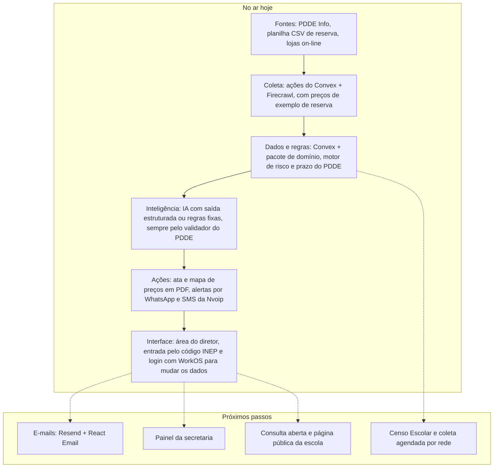

# Aloca

**Nenhuma escola perde o que já é dela.**

O **Aloca** é uma plataforma que ajuda o diretor e a Unidade Executora (APM, caixa escolar) a planejar e gastar o dinheiro do **PDDE** antes que ele volte para o governo. O centro do produto é o **plano de compra**: a partir dos dados públicos do FNDE, ele mostra o que a escola pode comprar com o saldo que tem, com o prazo sempre visível no topo, e entrega os orçamentos e a ata prontos.

> Projeto do **Hack Brasil 2026** · Trilha **Acesso à educação**

## 🎯 O problema

* Escolas deixam o recurso do PDDE parado no banco por falta de tempo, medo de errar nas regras ou demora para juntar orçamentos.
* A partir de 2027, pela Resolução CD/FNDE 18/2025, o saldo do PDDE Básico precisa ser usado até o décimo dia útil de fevereiro do ano seguinte. O que sobrar volta para o governo, e o próximo repasse só cai em conta zerada.
* O governo já mostra o saldo, mas ninguém ajuda o diretor a transformar esse saldo em compra dentro do prazo.

## 💡 A solução

Um ciclo só: **detectar → decidir → executar → mostrar**.

| Etapa | O que a plataforma faz |
|---|---|
| Detectar | Saldo, repasses e pendências de cada escola, lidos no PDDE Info (ou importados por planilha CSV quando o site está fora do ar) |
| Decidir | Risco de estorno com contagem de dias úteis e plano de compra sugerido por IA, cruzando saldo, o que a escola precisa e regras do programa |
| Executar | Pesquisa de 3 preços por item, ata da Unidade Executora e mapa de preços em PDF |
| Mostrar | Próximo passo: página pública da escola com o que recebeu, o que planejou e o que ainda está parado |

O plano de compra é a entrega principal, com um contador de dias até o prazo no topo. Alertas por WhatsApp, com SMS de reserva, avisam diretor e tesoureiro quando o prazo se aproxima. Alertas por e-mail e o resumo semanal da rede para a secretaria estão no roteiro depois do hackathon.

A prestação de contas continua no sistema oficial do FNDE. A plataforma cuida do que vem antes dela.

## ✨ Diferencial

* **Resolve, não só avisa:** o governo já mostra o saldo; nós entregamos o plano de compra, os preços e a ata.
* **Cada sugestão cita a regra** que a permite, com aprovação humana obrigatória.
* **Feito para o diretor:** linguagem simples e prazo sempre visível.
* **Olhar é livre, mudar exige conta:** qualquer pessoa vê o saldo e o plano de uma escola pelo código INEP. Para montar o plano, cadastrar celulares e mandar alertas, a pessoa entra com a conta (WorkOS) e assume a escola, e depois chama o tesoureiro por convite. A escola de demonstração fica aberta para todos.

## 👥 Para quem

| Perfil | Uso |
|---|---|
| Diretor e Unidade Executora (APM, caixa escolar) | Alerta de prazo, plano de compra, preços e ata |
| Secretaria de educação | Próximo passo: painel da rede com escolas em risco e pendências |
| Pais e conselho escolar | Próximo passo: página pública com o que a escola recebeu e gastou |

Quem contrata é a **secretaria de educação**, com assinatura por escola. É ela que analisa as contas das escolas da rede, e pendência na prestação de contas suspende o repasse. Escolas e famílias não pagam.

## ⚙️ Como funciona

1. O diretor digita o código INEP e uma ação do Convex lê o saldo na consulta pública do PDDE Info. Se o site estiver fora do ar, o saldo entra por uma planilha CSV na própria tela da escola.
2. Os dados entram no banco com fonte e horário da coleta.
3. O motor de regras calcula o risco de estorno, os dias úteis até o prazo e as pendências.
4. A IA sugere os itens do plano de compra (sem chave de IA, regras fixas fazem isso) e um validador barra o que o PDDE não paga antes de salvar.
5. O Firecrawl busca três preços por item nas lojas. Sem a chave, ou quando a busca falha ou não acha preço, entram preços de exemplo, marcados como exemplo para o diretor trocar pelos orçamentos reais.
6. Com o plano aprovado, a ata da APM e o mapa de preços saem prontos para imprimir ou salvar em PDF.
7. Uma rotina diária manda o alerta de prazo por WhatsApp ou SMS (Nvoip), e a área do diretor atualiza em tempo real.

## 🏗️ Arquitetura

O que está no ar hoje fica no bloco de cima. O tracejado é o roteiro depois do hackathon.



## 🧰 Tecnologias

| Camada | Tecnologia | Situação |
|---|---|---|
| Frontend | Next.js 16, Tailwind CSS 4, shadcn/ui | No ar |
| Backend e banco | Convex (dados em tempo real, ações e rotina diária de alertas) | No ar |
| Coleta de dados | Consulta pública do PDDE Info (ação Convex), planilha CSV de reserva e Firecrawl (lojas) | No ar |
| IA | LLM compatível com a API da OpenAI, com saída estruturada, regras fixas de reserva e validador | No ar |
| Documentos | Ata e mapa de preços em página de impressão, salvos em PDF pelo navegador | No ar |
| WhatsApp e SMS | Nvoip (template aprovado pela Meta, SMS como reserva) | No ar |
| Hospedagem | Vercel (site) e Convex (funções e banco) | No ar |
| Testes | Vitest, convex-test e Playwright | No ar |
| Login | WorkOS AuthKit, com o token validado pelo Convex | No ar |
| E-mail | Resend + React Email | Próximo passo |

## 📊 Fontes de dados

* **PDDE Info (FNDE):** saldos, repasses e pendências por escola, na consulta pública por código INEP. O PDDE Info não separa o saldo entre custeio e capital, então a divisão segue a proporção dos repasses do ano. Se o site estiver fora do ar, o diretor clica em **Importar planilha CSV** na tela da escola. A planilha precisa das colunas código INEP, exercício, custeio e capital (nome da escola e município são opcionais) e de uma linha com o código INEP da escola. Ela só entra numa escola que ainda não tem saldo salvo, para não sobrescrever o que veio do PDDE Info, aceita exercícios de 1995 até o ano da importação e não vale para a escola de demonstração. Importar exige conta, e quem importa passa a cuidar da escola no Aloca.
* **Escola de demonstração (INEP 35079923):** a EMEF Professora Teruyo Kikuta tem um saldo real guardado no `@aloca/dominio` (`ESCOLA_EXEMPLO`), coletado no PDDE Info em 18 de novembro de 2026. Uma rotina de hora em hora (`demonstracao.restaurar`) cadastra a escola com esse saldo quando ela ainda não tem saldo no banco, e apaga o plano e os celulares dela depois de uma hora sem mudanças. Se o PDDE Info estiver fora do ar quando alguém entra com esse código, a consulta mostra o saldo guardado com um aviso, então a demo funciona até num deployment novo. A escola de demonstração não cadastra celular nem envia alertas.
* **Lojas on-line:** preços para a pesquisa de três orçamentos, pelo Firecrawl. Sem a chave, ou quando a busca falha ou não acha preço, entram até três preços de exemplo do mesmo tipo do item, guardados com origem "exemplo" e avisados ao diretor.
* **Censo Escolar e Catálogo de Escolas (INEP):** infraestrutura e dados de cada escola. Próximo passo.

Todo número exibido guarda a fonte e o momento da coleta.

## 🔒 Dados e privacidade

* Usamos apenas **dados institucionais e públicos** das escolas.
* Nenhum dado pessoal de alunos, diretores ou responsáveis é exibido.
* Chaves e segredos ficam em variáveis de ambiente, fora do repositório.
* As ações que custam dinheiro ou incomodam alguém têm limite por hora, contado a cada pedido na tabela `uso` do Convex: consultas ao PDDE Info, celulares cadastrados, planilhas, buscas de preço no Firecrawl, pedidos à IA e alertas enviados na hora. O alerta manual é reservado antes de sair, então pedidos ao mesmo tempo não mandam a mesma mensagem duas vezes.

## 🚀 Como rodar

**Pré-requisitos:** Node.js 20+ e pnpm.

```bash
git clone https://github.com/JoaoBreganon/Hack-Brasil.git
cd Hack-Brasil
pnpm install
cp .env.example .env.local
pnpm dev
```

**Variáveis de ambiente**

O `.env.local` da raiz guarda as variáveis do site. O `pnpm convex:dev` preenche as do Convex na primeira vez.

```env
NEXT_PUBLIC_SITE_URL=
CONVEX_DEPLOYMENT=
NEXT_PUBLIC_CONVEX_URL=
CONVEX_SITE_URL=
WORKOS_CLIENT_ID=
WORKOS_API_KEY=
WORKOS_COOKIE_PASSWORD=
NEXT_PUBLIC_WORKOS_REDIRECT_URI=
```

`E2E_URL` e `E2E_PORTA`, também no `.env.example`, são opcionais e só valem para os testes de ponta a ponta.

**Login (WorkOS AuthKit)**

1. No [painel da WorkOS](https://dashboard.workos.com), copie o Client ID e a API key do ambiente. Em **Redirects**, cadastre `http://localhost:3000/conta/retorno` como Redirect URI e `http://localhost:3000/conta/entrar` como Initiate login URI, e ponha `http://localhost:3000/entrar` em **App homepage URL** (para onde o Sair leva, junto com o `returnTo` da rota `/conta/sair`). Troque pelo endereço publicado na Vercel. O ambiente local do projeto já está cadastrado.
2. Preencha as quatro variáveis `WORKOS_*` acima no `.env.local` (e na Vercel), com `NEXT_PUBLIC_WORKOS_REDIRECT_URI=http://localhost:3000/conta/retorno` no ambiente local. `WORKOS_COOKIE_PASSWORD` tem pelo menos 32 caracteres: gere com `openssl rand -base64 24`. A `WORKOS_API_KEY` é opcional para só entrar e sair.
3. Defina o mesmo Client ID no Convex, que valida o token de quem entrou: `npx convex env set WORKOS_CLIENT_ID client_...`. O Convex exige essa variável em todo deployment, porque o `convex/auth.config.ts` a usa. Num deployment sem login, um valor qualquer basta (por exemplo `client_sem_login`): ninguém entra, e só a escola de demonstração aceita mudanças.

Sem `NEXT_PUBLIC_WORKOS_REDIRECT_URI`, o site esconde o botão de entrar e as escolas ficam só para leitura, menos a de demonstração.

**Quem pode mudar uma escola:** quem assume a escola primeiro (ou importa a planilha CSV dela) passa a cuidar dela e chama outras pessoas pela tela **Quem cuida**, com um link de convite que vale por 7 dias e para uma pessoa só. Cada conta cuida de até 20 escolas. Se alguém assumir uma escola por engano, libere pelo painel do Convex com `npx convex run acessos:liberarEscola '{"codigoInep":"..."}'`.

As chaves dos serviços ficam no próprio Convex, porque é lá que as funções rodam. Nenhuma é obrigatória para a demo: sem a `FIRECRAWL_API_KEY` a busca de preços usa preços de exemplo, sem a `LLM_API_KEY` a sugestão de itens usa as regras fixas, e sem as chaves da Nvoip o envio de alertas avisa que não está configurado. E-mail (Resend) ainda não está no código, então não precisa de chave.

```bash
npx convex env set FIRECRAWL_API_KEY fc-...
npx convex env set NVOIP_NUMBERSIP ...
npx convex env set NVOIP_USER_TOKEN ...
npx convex env set NVOIP_CLIENT_ID ...
npx convex env set NVOIP_CLIENT_SECRET ...
npx convex env set NVOIP_WHATSAPP_INSTANCE ...
npx convex env set NVOIP_WHATSAPP_TEMPLATE ...
npx convex env set LLM_API_KEY sk-...
npx convex env set LLM_MODEL gpt-4o-mini
npx convex env set LLM_BASE_URL https://api.openai.com/v1
```

Sem a instância e o template do WhatsApp, o alerta vai só por SMS.

A `LLM_API_KEY` liga a sugestão de itens por IA em Compras. O Convex manda ao modelo o saldo livre de custeio e de capital, os tipos de despesa que o PDDE paga e não paga e o que o diretor escreveu, e pede a resposta em JSON com esquema fixo (saída estruturada). A chamada segue a API de chat da OpenAI, então `LLM_MODEL` e `LLM_BASE_URL` (opcionais, com padrão `gpt-4o-mini` e `https://api.openai.com/v1`) permitem usar outro provedor compatível. Sem a chave, ou quando a IA falha ou passa de 30 pedidos na hora, as sugestões saem das regras fixas do PDDE. Nos dois casos o validador do `@aloca/dominio` barra conta de consumo, pessoal, servidor público, aluguel, tarifa bancária, tributo e o resto do que o PDDE não paga antes de salvar ou mostrar qualquer item.

**Comandos**

| Comando | O que faz |
|---|---|
| `pnpm dev` | sobe o app em http://localhost:3000 |
| `pnpm convex:dev` | sobe o backend Convex |
| `pnpm convex:limpar` | tira os comentários que o Convex escreve em `convex/_generated` (rodar antes de cada commit que mexer no Convex) |
| `pnpm test` | roda os testes do domínio e das funções do Convex |
| `pnpm test:e2e` | roda os testes de ponta a ponta do diretor no navegador (Playwright) |
| `pnpm typecheck` | confere os tipos de todos os pacotes, do Convex e dos testes de ponta a ponta |
| `pnpm lint` | roda o ESLint |
| `pnpm build` | gera o build de produção do site, o mesmo da Vercel |
| `pnpm format` | formata o código com tab (Prettier) |

**Testes de ponta a ponta**

Os testes em `e2e/` percorrem o caminho do diretor no navegador: página inicial, entrada pelo código INEP da escola de demonstração (35079923), o pedido de login para importar a planilha de uma escola sem saldo, saldo e calendário do prazo no Início, compras com o item vedado barrado e a busca de preços, aprovação do plano, ata da APM com o mapa de preços, alertas e o menu no celular.

```bash
pnpm exec playwright install chromium
pnpm convex:dev
pnpm test:e2e
```

* **Convex:** os testes precisam de um Convex com as funções atuais. O `pnpm convex:dev` publica as funções no deployment de desenvolvimento e grava `NEXT_PUBLIC_CONVEX_URL` no `.env.local`, que o Playwright lê. Sem essa variável o Playwright para antes de começar e diz o que falta.
* **Site:** o Playwright sobe o `next dev` na porta 3000, ou usa o que já estiver rodando nela. `E2E_PORTA` troca a porta. `E2E_URL` aponta os testes para um site já publicado, como uma prévia da Vercel, sem subir servidor.
* **Dados:** o caminho do diretor roda na escola de demonstração, que é aberta e não pede conta, então os testes não precisam da WorkOS. Cada execução começa pelo botão **Recomeçar a demonstração** e monta o plano dela do zero. Se o PDDE Info estiver fora do ar, a escola entra com o saldo guardado. A escola com código INEP começando em 99 (nenhum estado usa esse código) só serve para conferir que a planilha pede login, e não fica salva. Não rode contra a produção, para não mexer na demonstração que os jurados estão vendo. O login de verdade e as regras de quem pode mudar cada escola são testados no `convex/fluxo.test.ts`.
* **Chaves:** sem chaves no Convex, os testes passam pelos preços de exemplo e pelas regras fixas. Com a `FIRECRAWL_API_KEY` ou a `LLM_API_KEY` configuradas, os testes aceitam o resultado real, mas demoram mais e gastam créditos. O teste nunca cadastra celular, então nenhum alerta sai.
* **Falhas:** o relatório fica em `playwright-report/` (`pnpm exec playwright show-report`) e os rastros em `test-results/`.

## 🗂️ Estrutura

```
apps/web/              Next.js: área do diretor
  src/app/             páginas e SEO (robots, sitemap, imagens de compartilhamento)
    entrar/            entrada pelo código INEP e as escolas de quem entrou
    conta/             entrar, retorno e sair da conta (WorkOS AuthKit)
    convite/[codigo]/  aceitar o convite para cuidar de uma escola
    escola/[inep]/     início (saldo e calendário do prazo), compras, plano, ata, alertas e quem cuida
  src/proxy.ts         sessão da WorkOS em cada pedido, desligada quando o login não está configurado
  src/components/      uma pasta por tela (inicio/, compras/, plano/, ata/, alertas/, pessoas/, entrar/, convite/), conta/ com o botão de entrar e sair, escola/ com o menu, o aviso de acesso e o que as telas dividem, calendario/, seo/ e ui/ (shadcn)
  src/hooks/           painel da escola vindo do Convex, conta de quem entrou e operações com aviso de erro
  src/lib/             próximo passo do diretor, caminho de volta depois do login e mensagens de erro
  src/config/          dados do site e áreas do menu
  src/fontes/          Bricolage Grotesque e Geist, servidas localmente
convex/                banco, funções e rotinas agendadas
  lib/                 Firecrawl, Nvoip, IA (LLM), requisição com tempo limite, regras do plano e quem pode mudar cada escola
  auth.config.ts       tokens da WorkOS que o Convex aceita
  acessos.ts           assumir a escola, convites, quem cuida e liberar a escola
  pddeInfo.ts          coleta do saldo no PDDE Info
  saldos.ts            saldo coletado e importação por planilha CSV quando o PDDE Info cai
  painel.ts            tudo o que as telas da escola mostram, numa consulta só
  sugestoes.ts         sugestão de itens pela IA ou pelas regras fixas, sempre pelo validador
  precos.ts            busca de preços no Firecrawl, com preços de exemplo de reserva
  demonstracao.ts      escola de demonstração sempre carregada, com o saldo guardado, e restaurada depois de uma hora parada
  itens.ts, orcamentos.ts, planos.ts, contatos.ts, alertas.ts, crons.ts
packages/dominio/      regras do PDDE, sem dependências externas e com testes
  src/calendario/      dias úteis, feriados nacionais, Carnaval e os meses do calendário do prazo
  src/prazo/           10º dia útil de fevereiro e estorno
  src/risco/           nível de risco de perder o saldo
  src/regras/          o que pode e o que não pode ser comprado, com a norma citada
  src/orcamento/       três orçamentos, menor preço, leitura da busca nas lojas e preços de exemplo
  src/plano/           plano de compra dentro do saldo de cada categoria
  src/sugestao/        sugestão de itens: esquema da IA, regras fixas sem chave e validador que barra despesa vedada
  src/formato/         moeda e data em pt-BR
  src/importacao/      leitura do PDDE Info e importação de saldos por CSV
  src/alerta/          template do WhatsApp e SMS de reserva do alerta de prazo
  src/ata/             texto da ata da APM e mapa de preços
  src/contato/         celular com DDD e máscara
  src/exemplos/        escola exemplo da demo
e2e/                   testes de ponta a ponta do diretor (Playwright), configurados em playwright.config.ts
```

## 🏆 Hack Brasil 2026

* **Trilha:** Acesso à educação
* **Demo:** `<link da demo>`
* **Vídeo:** `<link do vídeo>`

## 📄 Licença

Este projeto **não é open source**. O código é distribuído sob a **Business Source License 1.1**, com permissão adicional para que jurados, mentores e organizadores do Hack Brasil possam **ler, executar e testar** todo o código para fins de avaliação. Uso em produção ou comercial exige autorização escrita do time. Em 29 de novembro de 2030 (Change Date), o código passa para a **Apache License 2.0**. Veja o arquivo `LICENSE`.

## 👩‍💻 Time

* Guilherme Carvalho Mais
* Gabriel Duarte Frias
* João Gabriel Breganon Ferreira
