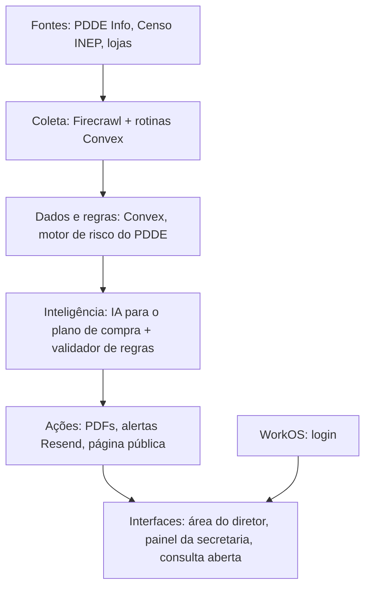

# Aloca

**Nenhuma escola perde o que já é dela.**

O **Aloca** é uma plataforma que ajuda o diretor e a Unidade Executora (APM, caixa escolar) a planejar e gastar o dinheiro do **PDDE** antes que ele volte para o governo. O centro do produto é o **plano de compra**: a partir dos dados públicos do FNDE, ele mostra o que a escola pode comprar com o saldo que tem, com o prazo sempre visível no topo, e entrega os orçamentos e a ata prontos.

> Projeto do **Hack Brasil 2026** · Trilha **Acesso à educação**

## 🎯 O problema

* Escolas deixam o recurso do PDDE parado no banco por falta de tempo, medo de errar nas regras ou demora para juntar orçamentos.
* A partir de 2027, pela Resolução CD/FNDE 18/2025, o saldo do PDDE Básico precisa ser usado até o décimo dia útil de fevereiro do ano seguinte. O que sobrar volta para o governo, e o próximo repasse só cai em conta zerada.
* O governo já mostra o saldo, mas ninguém ajuda o diretor a transformar esse saldo em compra dentro do prazo.

## 💡 A solução

Um ciclo só: **detectar → decidir → executar → mostrar**.

| Etapa | O que a plataforma faz |
|---|---|
| Detectar | Saldo por conta, repasses e pendências de cada escola, coletados no PDDE Info |
| Decidir | Risco de estorno com contagem de dias úteis e plano de compra sugerido por IA, cruzando saldo, necessidades da escola (Censo Escolar) e regras do programa |
| Executar | Pesquisa de 3 preços por item, ata da Unidade Executora e consolidação de preços em PDF |
| Mostrar | Página pública da escola com o que recebeu, o que planejou e o que ainda está parado |

O plano de compra é a entrega principal, com um contador de dias até o prazo no topo. Alertas por e-mail avisam diretor e tesoureiro quando o prazo se aproxima ou surge uma pendência, e a secretaria recebe um resumo semanal da rede.

A prestação de contas continua no sistema oficial do FNDE. A plataforma cuida do que vem antes dela.

## ✨ Diferencial

* **Resolve, não só avisa:** o governo já mostra o saldo; nós entregamos o plano de compra, os preços e a ata.
* **Cada sugestão cita a regra** que a permite, com aprovação humana obrigatória.
* **Feito para o diretor:** linguagem simples e prazo sempre visível.
* **Consulta aberta:** qualquer escola vê sua situação pelo código INEP.

## 👥 Para quem

| Perfil | Uso |
|---|---|
| Diretor e Unidade Executora (APM, caixa escolar) | Alerta de prazo, plano de compra, preços e ata |
| Secretaria de educação | Painel da rede com escolas em risco e pendências |
| Pais e conselho escolar | Página pública com o que a escola recebeu e gastou |

Quem contrata é a **secretaria de educação**, com assinatura por escola. É ela que analisa as contas das escolas da rede, e pendência na prestação de contas suspende o repasse. Escolas e famílias não pagam.

## ⚙️ Como funciona

1. Rotinas agendadas coletam os dados do PDDE Info por rede, ou sob demanda na consulta aberta.
2. Os dados entram no banco com fonte e horário da coleta.
3. O motor de regras calcula o risco de estorno, os dias úteis até o prazo e as pendências.
4. A IA sugere os itens do plano de compra (sem chave de IA, regras fixas fazem isso) e um validador barra o que o PDDE não paga antes de salvar.
5. O sistema busca preços e gera os documentos em PDF.
6. Alertas são enviados e a área do diretor, o painel e a página pública atualizam em tempo real.

## 🏗️ Arquitetura



## 🧰 Tecnologias

| Camada | Tecnologia |
|---|---|
| Frontend | Next.js, Tailwind CSS, shadcn/ui |
| Backend e banco | Convex (dados em tempo real e rotinas agendadas) |
| Coleta de dados | Consulta pública do PDDE Info (ação Convex) e Firecrawl (lojas) |
| IA | LLM com saída estruturada e validação por regras |
| Documentos | Ata e mapa de preços em página de impressão, salvos em PDF pelo navegador |
| Login | WorkOS |
| E-mail | Resend + React Email |
| WhatsApp e SMS | Nvoip (template aprovado pela Meta, SMS como reserva) |
| Hospedagem | Vercel |
| Testes | Vitest e convex-test |

## 📊 Fontes de dados

* **PDDE Info (FNDE):** saldos, repasses e pendências por escola, na consulta pública por código INEP. O PDDE Info não separa o saldo entre custeio e capital, então a divisão segue a proporção dos repasses do ano. Se o site estiver fora do ar, o saldo entra por planilha CSV.
* **Censo Escolar e Catálogo de Escolas (INEP):** infraestrutura e dados de cada escola.
* **Lojas on-line:** preços para a pesquisa de três orçamentos.

Todo número exibido guarda a fonte e o momento da coleta.

## 🔒 Dados e privacidade

* Usamos apenas **dados institucionais e públicos** das escolas.
* Nenhum dado pessoal de alunos, diretores ou responsáveis é exibido.
* Chaves e segredos ficam em variáveis de ambiente, fora do repositório.

## 🚀 Como rodar

**Pré-requisitos:** Node.js 20+ e pnpm.

```bash
git clone https://github.com/JoaoBreganon/Hack-Brasil.git
cd Hack-Brasil
pnpm install
cp .env.example .env.local
pnpm dev
```

**Variáveis de ambiente**

O `.env.local` da raiz guarda as variáveis do site. O `pnpm convex:dev` preenche as do Convex na primeira vez.

```env
NEXT_PUBLIC_SITE_URL=
CONVEX_DEPLOYMENT=
NEXT_PUBLIC_CONVEX_URL=
CONVEX_SITE_URL=
```

As chaves dos serviços ficam no próprio Convex, porque é lá que as funções rodam. Sem elas, a busca de preços e o envio de alertas avisam que não estão configurados e o resto funciona.

```bash
npx convex env set FIRECRAWL_API_KEY fc-...
npx convex env set NVOIP_NUMBERSIP ...
npx convex env set NVOIP_USER_TOKEN ...
npx convex env set NVOIP_CLIENT_ID ...
npx convex env set NVOIP_CLIENT_SECRET ...
npx convex env set NVOIP_WHATSAPP_INSTANCE ...
npx convex env set NVOIP_WHATSAPP_TEMPLATE ...
npx convex env set LLM_API_KEY sk-...
npx convex env set LLM_MODEL gpt-4o-mini
npx convex env set LLM_BASE_URL https://api.openai.com/v1
```

Sem a instância e o template do WhatsApp, o alerta vai só por SMS.

A `LLM_API_KEY` liga a sugestão de itens por IA em Compras. O Convex manda ao modelo o saldo livre de custeio e de capital, os tipos de despesa que o PDDE paga e não paga e o que o diretor escreveu, e pede a resposta em JSON com esquema fixo (saída estruturada). A chamada segue a API de chat da OpenAI, então `LLM_MODEL` e `LLM_BASE_URL` (opcionais, com padrão `gpt-4o-mini` e `https://api.openai.com/v1`) permitem usar outro provedor compatível. Sem a chave, ou quando a IA falha ou passa de 30 pedidos na hora, as sugestões saem das regras fixas do PDDE. Nos dois casos o validador do `@aloca/dominio` barra conta de consumo, pessoal, servidor público, aluguel, tarifa bancária, tributo e o resto do que o PDDE não paga antes de salvar ou mostrar qualquer item.

**Comandos**

| Comando | O que faz |
|---|---|
| `pnpm dev` | sobe o app em http://localhost:3000 |
| `pnpm convex:dev` | sobe o backend Convex |
| `pnpm convex:limpar` | tira os comentários que o Convex escreve em `convex/_generated` (rodar antes de cada commit que mexer no Convex) |
| `pnpm test` | roda os testes do domínio e das funções do Convex |
| `pnpm typecheck` | confere os tipos de todos os pacotes |
| `pnpm lint` | roda o ESLint |
| `pnpm format` | formata o código com tab (Prettier) |

## 🗂️ Estrutura

```
apps/web/              Next.js: área do diretor
  src/app/             páginas e SEO (robots, sitemap, imagens de compartilhamento)
    entrar/            entrada pelo código INEP
    escola/[inep]/     início (saldo e calendário do prazo), compras, plano, ata e alertas
  src/components/      uma pasta por tela (inicio/, compras/, plano/, ata/, alertas/, entrar/), escola/ com o menu e o que as telas dividem, calendario/, seo/ e ui/ (shadcn)
  src/hooks/           painel da escola vindo do Convex e operações com aviso de erro
  src/lib/             próximo passo do diretor e mensagens de erro
  src/config/          dados do site e áreas do menu
  src/fontes/          Bricolage Grotesque e Geist, servidas localmente
convex/                banco, funções e rotinas agendadas
  lib/                 Firecrawl, Nvoip, IA (LLM), requisição com tempo limite e regras do plano
  pddeInfo.ts          coleta do saldo no PDDE Info
  painel.ts            tudo o que as telas da escola mostram, numa consulta só
  sugestoes.ts         sugestão de itens pela IA ou pelas regras fixas, sempre pelo validador
  itens.ts, orcamentos.ts, planos.ts, precos.ts, contatos.ts, alertas.ts, crons.ts
packages/dominio/      regras do PDDE, sem dependências externas e com testes
  src/calendario/      dias úteis, feriados nacionais, Carnaval e os meses do calendário do prazo
  src/prazo/           10º dia útil de fevereiro e estorno
  src/risco/           nível de risco de perder o saldo
  src/regras/          o que pode e o que não pode ser comprado, com a norma citada
  src/orcamento/       três orçamentos e menor preço
  src/plano/           plano de compra dentro do saldo de cada categoria
  src/sugestao/        sugestão de itens: esquema da IA, regras fixas sem chave e validador que barra despesa vedada
  src/formato/         moeda e data em pt-BR
  src/importacao/      leitura do PDDE Info e importação de saldos por CSV
  src/alerta/          template do WhatsApp e SMS de reserva do alerta de prazo
  src/ata/             texto da ata da APM e mapa de preços
  src/contato/         celular com DDD e máscara
  src/exemplos/        escola exemplo da demo
```

## 🏆 Hack Brasil 2026

* **Trilha:** Acesso à educação
* **Demo:** `<link da demo>`
* **Vídeo:** `<link do vídeo>`

## 📄 Licença

Este projeto **não é open source**. O código é distribuído sob a **Business Source License 1.1**, com permissão adicional para que jurados, mentores e organizadores do Hack Brasil possam **ler, executar e testar** todo o código para fins de avaliação. Uso em produção ou comercial exige autorização escrita do time. Veja o arquivo `LICENSE`.

## 👩‍💻 Time

* Guilherme Carvalho Mais
* Gabriel Duarte Frias
* João Gabriel Breganon Ferreira
